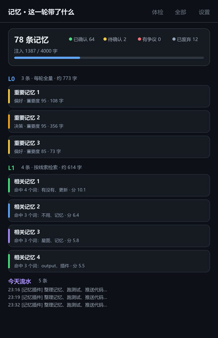
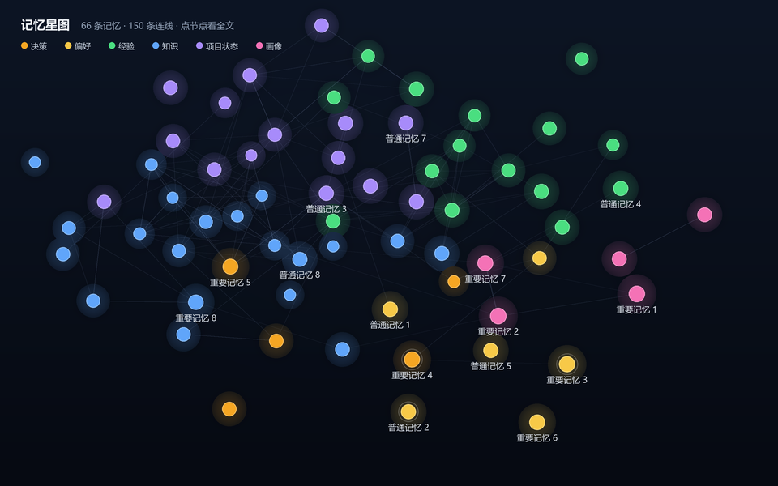

# dsh-memory-yuan

给 DeepSeek Harness 用的**文件式记忆插件**：一条记忆一个 Markdown 文件，每轮自动注入最要紧的几条，其余的按线索检索、按需展开。

它不是「记忆管理器」。它想解决的是三件事：

1. **记忆在文件里，不在别人的 JSONL 里**——能读、能改、能 git、能 Obsidian 打开。
2. **每轮只带最要紧的**——不是把所有记忆塞进提示词，而是 L0 全量几条 + L1 按这轮的话命中几条。
3. **看不到过程的地方，做成看得见的**——这一轮为什么命中这条、最近写过什么、哪些该处理了。

## 三层注入

| 层 | 什么时候 | 放什么 | 预算 |
| --- | --- | --- | --- |
| **L0** | 每轮 | `pinned: true` 且 `status: verified` 的 decision / preference | 约 800 字，12 条封顶 |
| **L1** | 每轮 | 按**用户这轮说的话**做关键词检索，命中的记忆各给一行 | 4 条，约 600 字 |
| **L2** | 需要时 | 日记、交接、笔记 | 不注入，只给路径 |

L0 是「不看到就会做错事」的硬规矩；L1 是「这轮刚好提到」的线索；剩下的一律靠 `memory_search` / `memory_get` 主动查。

## 目录结构

```
memory/                      ← vault，整库就是你自己的文件夹
├── Decisions/               ← decision
├── Preferences/             ← preference
├── Experiences/             ← experience
├── Knowledge/               ← knowledge
├── Projects/State/          ← project-state
├── Profile/                 ← profile
├── Inbox/                   ← status: candidate 的候选
├── Archive/                 ← 归档（不删，随时能恢复）与旧库留档
├── Daily/2026-11-24.md      ← 每日流水，一行一条，不进索引
├── Projects/<项目名>.md     ← 项目流水，同样不进索引
└── .dsh-memory/             ← 运行态：索引、快照、锁、备份、命中计数（可删，会重建）
```

## 一条记忆长什么样

```markdown
---
id: mem_20261122t050801_a773390b
type: decision
status: verified
title: 唯一写入源：vault 文件
created_at: 2026-11-22 15:40:12
updated_at: 2026-11-24 21:09:33
tags: [记忆, 写入]
confidence: 0.9
importance: 92
pinned: true
evidence: 2026-11-22 会话 session-xxxx：「定下来吧」
expires: 2026-12-31
reads: 3
visibility: desktop-private
schema_version: 1
---

## 核心内容

一条只讲一件事。

## 来源与依据

哪来的、为什么这么定。

## 相关记忆

（可选）
```

`status` 四态：`candidate`（候选，等人确认）→ `verified`（人确认过，L0 的料）/ `disputed`（有争议，不注入）/ `superseded`（被替代，文件保留，能看出怎么变的）。

改记忆的规矩只有一条：**新建一条，把旧的标 superseded**，不覆盖。

## 工具

| 工具 | 干什么 |
| --- | --- |
| `memory_search` | 按关键词 / 标签 / 类型检索 |
| `memory_get` | 按 id 或路径读全文，记一次 reads；也能读 daily / project 流水 |
| `memory_write` | 写一条（默认 candidate，要 verified 得显式确认）；或追加流水。写前会查重（同 type 正文重合 ≥60% 的旧条目列出来提醒，不拦你写） |
| `memory_update` | 改已有条目的标题 / 标签 / 重要度 / 正文 / 出处 / 过期日；`expectedUpdatedAt` 防覆盖 |
| `memory_digest` | 读当天流水；写收盘小结 |
| `memory_review` | 体检：疑似过时 / 可能没用 / 可以合并 / 缺出处 / 已过期，每条带建议 |
| `memory_tend` | 按建议处理一批：只做可逆动作，不删文件，每条件一行流水 |
| `memory_lint` | 结构体检：frontmatter、type/status、tags、正文、id、目录，15 类结构问题 |
| `memory_explain` | 解释这轮 L0/L1 为什么是这几条：命中词、分数、被哪个阈值挡下 |
| `memory_export` | 导出记忆包（Markdown + MANIFEST.json 里每个文件的 sha256） |
| `memory_import` | 导入记忆包：先校验，同名不同内容另存，不覆盖 |
| `memory_archive` | 归档 / 恢复一条：挪进 Archive/，不删文件 |
| `memory_migrate` | 把旧库（dsh-memory-evolve 的 MEMORY.md / USER.md / KEY.md）拆进 Inbox，默认 dryRun |

## 界面

下面两张图是真库（66 条记忆）的界面：左边是面板「这一轮」，右边是星图。

<p>


</p>

- **记忆面板**（会话头部「记忆」）：这一轮带了什么（L0/L1 各几条、命中词）、最近写入、今天流水；每轮字数是写进 `last-inject.json` 的实算值，不是估算。下面还有「今天的收盘」，能直接看、直接改。
- **体检**：五张单子，每条附「建议」与「为什么」，能直接点「照建议处理」；合并候选能「对比两条」平铺对照、也能「都留着（不是重复）」；结构体检每条问题带「修」按钮（能自动修 11 类结构问题）。
- **记忆星图**（左栏）：节点=一条记忆，半径按重要性，颜色按类型，连线=同标签或标题词重合；深空底、按类型聚团，点节点看全文、悬停看摘要；拖拽平移、拖节点调位置（记住）、滚轮缩放（以鼠标为中心）、双击复位、右键出菜单（确认 / 每轮注入 / 废弃 / 归档）、导出 PNG。
- **全部**：搜索、按类型/状态筛、编辑、删除（移到 Archive）、补出处（从会话存档里找原话）。
- **流水**：把 `Daily/` 与 `Projects/` 当全文库，按词找某句话是哪天写的。
- **设置**：L1 的四个参数（最多几条、至少命中词、最低分、标题标签命中）、备份目录用量与清理。

## 原话回溯（配套脚本）

长期记忆在 vault，原话在 DSH 会话存档（`~/.dsh/sessions/`）。`scripts/查原话.mjs` 直接扫存档、按关键词找某句话（全程本地，只回命中几行）：

```bash
node scripts/查原话.mjs "关键词"                  # 默认扫房间工作区
node scripts/查原话.mjs "关键词" --session 38629beb --date 2026-11-25
node scripts/查原话.mjs "关键词" --workspace all --full
node scripts/查原话.mjs --list                    # 只列会话，不解压正文
```

## 共存（这台机器上还有别的记忆来源）

别处可能还装着别的记忆类插件，各有各的写法（有的写 jsonl、有的写 sqlite、有的在远程）。vault 只读自己目录下的 Markdown，不读别人的库，也不会互相覆盖。

`memory_lint` 会顺带看看这台机器上还有哪些记忆来源，认三类：

1. **dsh-world 的原话归档**——读 `profiles/*/node_modules/dsh-world/package.json` 拿版本，读 `worlds/*/archive.sqlite` 拿归档库；
2. **旧记忆库**——`~/.dsh/memories` 里的 `MEMORY.md` / `USER.md` / `projects/<id>/KEY.md`；
3. **别家记忆类插件**——`profiles/*/node_modules` 下名字像记忆插件的包（`dsh-memory-*`、`dsh-world*` 等），只列名字和版本，不读它们的数据。

检测到就在输出末尾多一段：

```
这台机器上还有别的记忆来源，vault 只读自己的 Markdown：
- dsh-world 0.8.5，原话归档在 default 的 archive.sqlite（原话走它的 memory_find，
  或用 scripts/查原话.mjs 直接扫会话存档）。
- 旧记忆库还在 ~/.dsh/memories（6 个条目文件），要搬进 vault 用 memory_migrate。
- dsh-world-room 0.1.0（自己的记忆存在自己那儿，vault 不读它）。
```

只提示、不改任何东西；一个都没检测到就没有这一段。这三类是实际认得的形状——别家插件写 JSONL、写远程库的，不会出现在这里，也不影响使用。

## 安装

作为 bundle 装进 profile：

```jsonc
// package.json
{
  "dependencies": { "dsh-memory-yuan": "link:C:/path/to/dsh-memory-yuan" },
  "bundles": ["dsh-memory-yuan"],
  "dsh": { "bundle": { "patch": "./cordis.patch.yml" } }
}
```

`node_modules/<包名>/` 必须是真实目录（不是链接），否则加载器会静默跳过。装完重启 DSH；改 `client.js` 后需要重载插件或刷新页面。

## 试一下（不碰真库）

```bash
node scripts/make-sample.mjs docs/sample-vault   # 12 条示例记忆
node scripts/preview.mjs docs/sample-vault       # 看 L0 文本
```

## 安全

面板与星图走的是 `ctx.webServer.register` 注册的 `/memory-yuan/*` 路由。这些路由**只对 DSH 自己的页面开放**：每个请求都先过 DSH 的信任闸（`connection.requestRejection`，0.2.3 及以后是 `connection.admit`），过不了的一律 `403 {"error":"forbidden"}`。

实测（本机）：无浏览器凭证的 `curl` 打 `/memory-yuan/state` 是 403，带伪造 `Origin` 也是 403；DSH 页面自己带登录凭证，正常。

`engines.dsh` 保持宽松（`>=0.2.1-rc.2 <0.3.0-0 || >=0.2.2-rc.1 <0.3.0-0`）：0.2.3 之前的宿主上没有这套闸，插件会**自动退回只绑本机**——路由仍然只监听本机地址，但不校验调用方来源，安全性弱一些，好处是老版本也能跑。

排查：如果你的面板打不开（极少见，通常是宿主版本的认证方式不同），可以在插件配置里写 `gateRoutes: false` 退回「只绑本机」的老行为——那是已知不安全的模式，只用来定位问题。

## 兼容与边界

- 只依赖 `systemPrompt` 与 `tools`；`webServer` / `llm` / `settings` 是可选能力，`ctx.inject` 按需挂——没装这些服务的宿主上插件照样加载，只是没有面板与收盘。
- 收盘定时器随 DSH 进程存活：DSH 没开就不跑，过点启动会补跑；每个会话各挂一个定时器，但靠共享的 `digest-state.json` 保证一天只写一次，写摘要还有跨进程锁。
- 并发写入用 `.dsh-memory/lock` 短时锁 + 写前比对 `expectedUpdatedAt`；同一台机器两个班次同时写，也不会悄悄覆盖。
- 每次改记忆都会在 `.dsh-memory/backups/` 留一份 `.bak`：同一文件留最近 5 份，跨文件总量超过 300 份或 20MB 时自动删最旧的（保底 20 份）。设置页能看到用量、也能手动清。
- 时区按本机本地时间（Asia/Shanghai）。

## License

MIT，见 [LICENSE](./LICENSE)。
